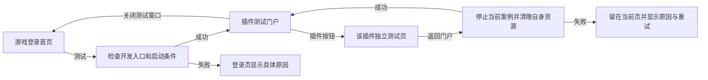

# SSLM 插件测试门户界面设计

日期：2026-10-28。状态：设计方案，尚未据此修改或验证实际界面。

## 目标和入口

在游戏登录首页设置清晰的「测试」按钮。点击后进入插件测试门户；门户以按钮呈现插件，点击某个插件按钮打开该插件独立测试页。保留已批准的逐插件页面、真实功能适配、运行状态和人工报告，不建立第二套测试执行器或插件目录。

当前源码中登录页已有 `PluginDevelopmentButton`，它调用 `UDivineBeastsPluginDemoLauncher`。现有实现通过开发启动器、完整 Editor 构建证据和固定启动脚本打开独立演示窗口，原登录窗口保留；它并不证明新门户样式或点击链已经实现。建议沿用该入口，将按钮显示文字设计为「测试」，入口启动后首先显示本门户。保留对单插件页面的既有直接入口。

开发入口遵循现有宿主规则：非 Shipping/Test、开发工具资格、Standalone、有效工程与构建证据；缺条件时按钮不可用并显示明确原因。登录提交或启动进行中禁止重复点击。测试入口不传递账号、密码或令牌，不自动登录；出现错误时保留登录界面并显示可理解的原因。

## 导航流程



门户在既有受控演示窗口打开；关闭后用户可继续操作原登录窗口。启动中提示「正在打开插件测试门户」，启动检查失败显示可采取的操作。是否将焦点自动恢复到登录窗口需以目标平台实际能力验证，不能把进程启动成功当作门户已显示。

## 界面布局

设计基准为 1920×1080；较小窗口按可用空间调整列数与滚动区域，不整体缩放文字和交互控件。

```text
┌──────────────────── SSLM · 插件测试门户 ─────────────────── 关闭 ┐
│ 选择插件，进入独立测试页          [搜索插件名称或 ID       ] [清除] │
├──────────────┬────────────────────────────────────────────────────┤
│ 全部         │ 全部插件  ·  70 项                  排序 [名称  ▾] │
│ 平台         │                                                    │
│ MOBA         │ [ 插件名称                 ] [ 插件名称           ] │
│ 项目         │ [ 简短用途                 ] [ 简短用途           ] │
│ 内容包       │ [ 运行端 · 测试状态        ] [ 运行端 · 测试状态  ] │
│ 编辑器插件   │                                                    │
│              │ [ 插件名称                 ] [ 插件名称           ] │
│ 测试状态 ▾   │ [ 简短用途                 ] [ 简短用途           ] │
│              │ [ 运行端 · 测试状态        ] [ 运行端 · 测试状态  ] │
│              │                       ··· 可滚动 ···               │
├──────────────┴────────────────────────────────────────────────────┤
│ 页面与接线进度分别统计；人工结论由测试人员填写。                 │
└───────────────────────────────────────────────────────────────────┘
```

左侧是分类及状态筛选；右侧为插件按钮网格，默认按名称排序。1920 宽可显示 3—4 列；1280 宽建议 2 列，更窄时 1 列，实际按内容区宽度计算。按钮不小于 240×104 逻辑像素，点击区域覆盖整张卡片；标题、说明、状态和图标适配内容宽度，超长名称截断并可查看完整名称。按钮文字至少 18 逻辑像素、标题建议 20；缩放和 DPI 变化以引擎真实布局验证为准。

每个按钮显示：插件中文名称，必要时附稳定 PluginId；一句真实用途；运行宿主（客户端、服务器、编辑器或内容包）；当前可操作状态。卡片按真实目录决定数量，当前盘点为 70 项，不把这个数字硬编码到运行逻辑。分类以现有目录的层级、类型、宿主元数据派生；一个插件可因属性同时出现在不同筛选结果中，身份始终为同一个 PluginId。原目录缺少的分类先补充可核验的元数据，不能根据名称臆测。

状态采用文字和形状共同表达，不能只靠颜色：

| 状态 | 页面显示与行为 |
| --- | --- |
| 可测试 | 允许进入独立页，页内按真实功能和宿主执行。 |
| 部分可测试 | 允许进入；独立页列出已接线功能与待完成项。 |
| 需要其他宿主或资源 | 允许进入说明页，显示具体前置条件，不能执行的功能明确禁用。 |
| 待接线 | 允许查看插件介绍和缺口，不以占位结果显示成功。 |
| 加载失败或不可用 | 展示原因和可用的重试；不得打开错误插件页。 |

人工「未测 / 通过 / 不通过」与接线、运行状态独立显示；只有人工明确提交才产生人工结论。门户上数字可按各状态统计，不将页面数当作功能完成率。搜索支持中文名与 PluginId，筛选、空结果和清除操作可用键盘访问；默认搜索只作用于已加载的目录快照。

## 视觉与交互

沿用 SSLM 公共 UI 主题：温润抛光玉石、流畅藤蔓与树叶、低对比自然细节、柔和宽阔高光。门户主体用清晰的半透明深绿面板承托文字，背景保持安静；避免颗粒、砂砾、细碎雕刻、锐化和过曝。正常、悬停、按下、选中、禁用及键盘焦点各有可辨状态；焦点使用连续边框与文字提示，不依赖闪烁。若制作真实纹理，遵循原 RGB、sRGB/Alpha、无损压缩与白色乘色合同。

鼠标点击和键盘 Enter/Space 均打开当前插件。Tab 在搜索、筛选、插件列表及关闭之间移动，方向键在按钮网格中按可见排序移动，Escape 返回上一级；手柄沿用项目已有导航。打开某页再返回时恢复分类、搜索词、滚动位置及原插件焦点；目录变更导致原项消失时回到列表首个可用项，并说明状态。输入/焦点在不同窗口和 LocalPlayer 之间隔离。

进入其他页或关闭门户前，当前案例按既有 Stop/清理合同释放自己的请求、订阅、租约和样板；清理失败时保留当前页、原因和重试入口，不清除其他运行者的资源。页面首次绑定读取一次快照，之后使用目录、运行状态、命令结束、视口/DPI 与输入设备通知更新；不引入 Tick、常驻 Ticker 或定时轮询业务状态。

## 接入与验收

- 复用 `PluginDemoManifest.json` 的作者源及其运行时 Catalog、Hub ViewModel 和现有固定 PluginId 独立页路由；门户为导航视图，不保存第二套业务状态或复制 70 套逻辑。
- 登录页复用 `PluginDevelopmentButton`、现有 Launcher 资格和启动脚本。门户仅消费已验证的启动结果；子进程启动、门户实际就绪及关闭应分别有准确状态，现有脚本的 Started 不足以证明界面 Ready。
- 通用 UI 机制归 GamePlatformUI，项目视觉与真实 UMG 资产归 DBAUIPack_Core，项目接线归 DBAClient。编辑器专属操作仍通过现有 Editor 宿主/桥；服务器权威功能要求真实隔离宿主，不由客户端模拟成功。
- 用直接 Monolith MCP 制作或修改真实 UMG，编译、保存、独立重载并核对目录、按钮、焦点、输入和路由；保留相关现有地图及 PlayerStart。所有 Cook/Bake、临时工作目录、Stage 与打包输出均在当前工程目录内。
- 验证登录页按钮可用、禁用和失败状态；真实门户打开、70 个身份逐一进入对应页及返回；搜索/筛选/排序、空状态、窗口尺寸/DPI、鼠标键盘焦点；切页取消与清理失败重试；客户端、Editor、服务器及内容包宿主提示。
- 测试账号与联网案例仅使用经验证的隔离环境；进入真实 Village/MainArena 前执行当前 Client/Server 战斗版本及 Cook/Stage 门禁。构建、原生资产、运行结果和人工视觉/操作签收分别记录。

## 当前完成边界

此前 70 个独立页面及入口切换已有原生验证；部分功能接线、客户端隔离及人工验收仍未完成。本文件是新增门户的设计，不表示门户 UMG、登录按钮文字、导航、构建、Cook 或人工验收已完成。
