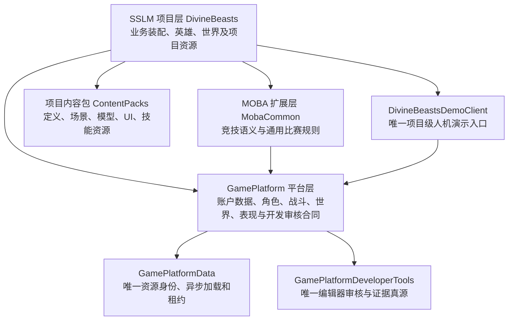
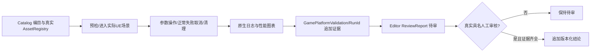

# SSLM 全插件体系优化设计 V2.0（2026-10-18）

> 文档性质：可执行设计规范，不是代码、蓝图、性能或人工验收完成证明。
> 工程：DivineBeastsWorkspace（唯一工作空间）/ Game/DivineBeastsArena.uproject（正式 UE5.8 游戏工程）。
> 适用范围：当前67个真实插件、89个声明模块、OpenWorld（常驻世界）、Village（新手村）、MainArena（主竞技场），以及PC与后续移动端。
> 上位规则：根目录 AGENTS.md（全局工程规则）、Game/Plugins/插件开发规范.md（插件开发规范）、Docs/Architecture/解决方案总体规划.md（总体规划）。
> 事实来源：CurrentPluginQualityMatrix.json（67插件静态质量台账）、PluginDeliveryManifest.json（交付基线）、PluginDemoManifest.json（演示编目唯一源）、ReviewHarness.md（人工审核框架）、RuntimeSafetyReview_20261018.md（运行期审查）。
> 约束：不更新原稳定插件名、模块名、反射身份、GameplayTag（玩法标签）、已发布主资产ID和工程名；不创建第二套资源管理、VFX、PCG、演示或审核系统。

## 一、设计决策及验收基线

SSLM已有三层插件结构和编目基础，主要问题不是模块数量少，而是“功能存在、运行可靠、性能可测、画面可验、人工可签收”之间缺少统一闭环。优化采取**局部整改 + 统一责任合同 + 正式演示接线**，不进行大面积重构。

2026-10-18当前快照：67插件=48代码机制+19内容包；89模块；41个平台层身份、2个MOBA层身份、24个项目层身份；45个插件具有模块内C++测试源码；53个需要可视化/交互审核，其中51个尚无正式操作案例；现有正式演示4项功能/9案例；19个插件可关联13张真实开发诊断地图，人工签收0。23处Ticker（周期轮询）与22处Tick（逐帧执行）为**源码候选**，没有实测CPU/GPU损耗。既有结构性扫描未检出插件描述或模块依赖P0错误，不代表67插件业务代码完全正确。

总体达成条件：每个真实插件有明确职责、范围、端侧、测试与版本；每个经审计确认的功能有正式案例或带审批理由的不适用记录；视觉/交互案例有真正可操作UI；服务器/客户端资源隔离有真Cook证据；性能有设备与场景测量；人工必须实际签收。未知功能分母不得计算百分比，不得把诊断地图、截图、脚本退出0或旧DLL视为最终通过。

## 二、现有三层架构的最小演进

### 2.1 模块与内容责任关系



平台层不引用具体生肖、项目UI或项目Niagara（粒子特效系统）；MOBA层可复用平台功能但不引用SSLM美术；项目层组合已有稳定机制和资源。没有新增职责的纯数据差异用 Definition/DataAsset（定义资产），不机械制造三层Actor/Subsystem（子系统）继承。

保留GamePlatformWorld（通用世界上下文）、GamePlatformPCG（程序化生成）、GamePlatformSurface（环境表面）、GamePlatformWater（水体）、GamePlatformWeather（天气）分离：World提供作用域；PCG主要编辑器生成与烘焙；Water的权威信息与客户端渲染隔离；Weather权威调度不依赖客户端VFX。禁止以“实现开放世界”为由恢复已退休的GamePlatformOpenWorld空壳。

GamePlatformLobby（通用大厅）、GamePlatformVillage（通用村庄）目前存在模块注册壳的风险，先审查稳定合同与真实消费位置，按已有职责补实际功能或明确保留/收敛，不再为它们创建新的服务器角色。大厅属于OpenWorld，教学训练属于Village；MainArena统一承载1v1—5v5，模式容量由数据定义确定。

### 2.2 七个责任域的边界

| 责任域 | 唯一归属与典型插件 | 不得发生 |
|---|---|---|
| 基础数据与应用流 | GamePlatformCore、Data、ApplicationFlow、Loading、Save、Settings | 并行资产管理器、UI自行决定权威状态 |
| 角色、技能与玩法 | Character、AbilitySystem、Combat、Gameplay、AI、Quest、Inventory、Equipment | 客户端装饰决定伤害、余额或匹配结果 |
| 世界与环境 | World、PCG、Water、Weather、Navigation、Surface | 服务器加载纯环境展示资产、项目资源硬写平台核心 |
| 客户端表现 | Presentation、MobaPresentation、VFX、SFX、Animation、Camera | 各自复制VFX池、绕过统一表现请求与版本租约 |
| 用户交互与显示 | UI、Input、CommerceUI、Localization、Progression、DBAClient、DBAUIPack_Core | Widget逐帧轮询业务、生产秘密进UI证据 |
| 在线与服务器 | Online、Session、Server、Telemetry、LiveOps、DBAServer | 客户端写权威状态、跨服旧回调污染新World |
| 开发审核与发布 | DeveloperTools、现有DemoHub、Build/Validation、Tests | 客户端反向链接Editor模块、AI冒签人类通过 |

### 2.3 模块依赖与端侧审计规则

只读核对.uplugin（插件描述）、.Build.cs（模块构建规则）、Public公开头、反射父类、蓝图父类、DataAsset和软硬引用。平台不能反向依赖MOBA/项目，客户端与服务器专有模块不相互引用，纯表现包不得被Dedicated Server（专用服务器）Cook。按实际Client、Editor和Server目标检查模块闭包、二进制与Pak/容器内容，`ClientOnly`标识不是Cook隔离的充分证据。

## 三、统一插件质量合同

在现有交付/演示台账之上设计**派生的质量视图**，不让各插件维护竞争性质量真源。每个插件视图建议包含以下审核字段：

| 字段（设计语义） | 含义与数据来源 |
|---|---|
| plugin_id（插件稳定身份） | 真正的.uplugin/内容登记，不能人为编造 |
| layer/module/target（层/模块/端侧） | 当前物理规则、构建目标与运行身份 |
| owner_scope（所有权作用域） | Process/GameInstance/World/LocalPlayer/Actor/Request中的真实所有者 |
| feature_inventory_state（功能范围审查状态） | 未审、部分、已确认；必须有真实接口与消费者证据 |
| runtime_evidence_state（运行证据状态） | 未执行、已编译、原生已测、集成已测、失败/阻断 |
| visual_scenario_state（场景状态） | 无、诊断图、已接线正式案例、已在引擎运行 |
| performance_state（性能状态） | 未测、已基线、对比已测、条件达标/失败 |
| human_review_state（人工状态） | 未审、待审、通过、失败、阻断/当前版本已过期 |
| cook_boundary_state（烘焙隔离） | 未审、规则检查、Client/Server真Cook及资产审计通过 |
| issue_and_evidence_refs（问题与证据） | 复现条件、修复版本、测试报告、实际文件哈希 |

严格保留“功能已实现”和“可人工操作”两项不同结论；可进入一张地图并不代表该地图已经接线真实业务。对尚未完成范围审查的插件，禁止展示100%覆盖率。

定义问题等级：P0（确定的权威、安全、编译/端侧隔离阻断）、P1（核心流程或必需人工操作缺口）、P2（有影响范围的性能/可维护性与自动测试缺口）、P3（已可工作但需要长期优化的细节）。`P1 51项`在当前台账中指正式案例缺口数量，非51处已确认代码漏洞。

## 四、运行期统一安全设计（针对真实已发现的高风险）

### 4.1 异步与生命周期不变量

所有跨网络、跨世界、跨资源租约的异步事务统一遵守：

```text
Acquire（申请）→ Validate（校验）→ Publish（发布当前代次）
→ Execute（执行）→ Complete/Fail/Cancel（唯一终态）
→ Unbind（解绑）→ ReleaseOwnLease（释放本调用者资源）
```

作用域身份至少能区分WorldEpoch（世界代次）、OperationId（本次操作身份）、Owner（拥有者）和目标。同步委托可能在当前调用栈内直接取消或析构，外部回调不在锁内执行；在不可回滚的地图旅行、发奖、网络提交、资源注册前必须再次核对身份和有效性。结束一个世界不能清空其他世界、本地玩家或游戏实例正在使用的租约。

具体落实：GamePlatformSession（跨服会话）的BeginTransfer同步失败不能返回成功，TFunction在同步完成/取消期间必须具有安全持有期；GamePlatformTelemetry（遥测）的一次性重试Ticker触发即移除、调度失败关闭批次、Shutdown幂等；GamePlatformData（数据）坚持唯一资源租约和异步取消；GamePlatformPCG（程序化生成）禁止客户端生成结果成为服务器玩法判定。

### 4.2 性能治理由证据驱动

将Tick/Ticker统一分为`真正每帧必需`、`有界低频更新`和`完全事件驱动`三类。UI业务状态默认事件驱动；VFX/天气/水/摄像机只保留确需画面刷新的任务；空闲Ticker按需启停，定时器触发即移出句柄；高频对象优先使用批量事件与实例化组件。不要仅靠静态搜索命中次数推断GPU/CPU性能。

以World/Client/Server/Editor（世界/客户端/专服/编辑器）四端独立量测：Game Thread（游戏线程）与Render Thread（渲染线程）P50/P95/P99、GPU耗时、DrawCall（绘制调用）、实例数/池命中、CPU/显存峰值、长时内存趋势、掉帧和业务指标。必须先建立Baseline（实测基线）再做一项改动、一项对比；环境、地图、摄像机、设备、画质、采样时长及源码/资源指纹保持一致。

竞技VFX沿用AGENTS中明确限定的候选：MainArena High/60FPS场景P95≤16.67ms、P99≤20ms、VFX GPU≤1.5ms、CPU≤0.6ms；Epic/120FPS须独立核验8.33ms。它们是竞技VFX候选而非全插件、全设备或开放世界统一门限。PCG、Water、UI、Online、Telemetry等没有正式项目阈值的条目先形成数据与建议，不私自造“达标”数字。

### 4.3 服务器专用资源及三世界

OpenWorld（常驻世界）、Village（新手村）、MainArena（竞技场）使用正式服务器角色配置，不创建额外Lobby（大厅）服务。玩法相关的碰撞、导航、出生、资源点和竞技几何必须权威或可一致烘焙；PCG装饰主要在编辑器生成/烘焙后以受控资源发布。Server资产清单必须证明没有不需要的UI Widget（界面控件）、Niagara、纯SFX、纯Surface、审核地图和高分辨率环境纹理。Client可以拥有相应的视觉包；Server不可从Client硬引用这些资源。

## 五、可视化插件必须提供可操作人工审核界面

### 5.1 唯一总体入口及宿主位置

不新增插件或独立.uproject（虚幻工程）。唯一入口使用`L_DBA_PluginDemoHub`（现有演示关卡）+ `WBP_DBA_PluginDemoHub`（现有根控件）+ `DivineBeastsDemoClient`（项目演示客户端）+ `GamePlatformDeveloperTools`（平台编辑器审核）。必要的新项目控件仍归DBAUIPack_Core（项目UI内容包）的开发专用范围。项目Widget Blueprint（控件蓝图）的新建、布局、动画、编辑、编译、保存、冷重载统一使用锁定工程中的Monolith MCP（虚幻引擎编辑器自动化工具）；普通文档或C++脚本不得伪造.uasset。

### 5.2 UI页面结构与操作闭环

```text
┌────────────────────────────────────────────────────────────────────────┐
│ SSLM 插件质量工作台  [目标 Editor/Client/Server] [构建版本] [刷新]   │
│ [搜索] [Platform/MOBA/Project] [代码/内容] [未审/阻断/待人工]           │
├─────────────────┬──────────────────────┬───────────────────────────────┤
│ 插件树与风险     │ 功能/案例列表         │ 选中案例详情                    │
│ • 模块身份       │ • 功能分母/状态       │ 所属层/模块/端侧/资产与消费者    │
│ • P0/P1/P2/P3   │ • 正式案例/诊断地图    │ 前置检查、参数与预期            │
│ • 测试与Cook状态 │ • 无案例时显示缺口    │ 启动资格、失败原因与证据要求     │
├─────────────────┴──────────────────────┴───────────────────────────────┤
│ [预检] [启动] [执行] [暂停/继续*] [停止] [重置] [返回总览] [报告/证据] │
├────────────────────────────────────────────────────────────────────────┤
│ 状态：未运行/准备/运行/已完成/失败/取消/待审核   事件日志与性能摘要      │
└────────────────────────────────────────────────────────────────────────┘
* 没有真实暂停能力的案例不得显示可操作的暂停按钮。
```

界面只读取只读ViewModel（视图模型）状态及异步事件，不对登录、背包、匹配、网络等业务状态使用Tick或常驻Ticker轮询。插件目录通过显式刷新/插件变更通知更新，67行菜单采用虚拟化及稳定身份复用；键盘/手柄焦点、屏幕安全区、窄视口及PC/移动端比例另做真实验证。状态同时使用中文标签、形状/图标及颜色，不以颜色单独表示成败。视觉符合当前SSLM Art V3（环境）与UI碧玉/玄墨青/鎏金主题；不篡改已有品牌源资源。

### 5.3 两类入口严格分开

- **诊断地图（Diagnostic Map）**：目前19个插件可进入13张真实开发地图，允许人工观察实际材质、环境、特效和场景构件；不能自动升级为`功能完整`、`性能通过`或`人工已签收`。
- **正式操作案例（Formal Scenario）**：必须在现有PluginDemoManifest.json（演示作者真源）登记稳定Feature/Scenario/ReviewCase身份、真实公开调用方、前置资产、允许的操作与清理、失败/取消路径；由当前DemoHub驱动真实场景、参数和结果，并以原生审核用例核对。一个地图可承载多个案例，但各案例独立签收。

建议优先把现有PCG Gold、寒冰箭VFX、主摄像机、天气/水、UI控件、战斗/交互六组诊断入口升级为**有参数/运行/取消/恢复能力的正式样板案例**，再复制其案例合同而非复制播放器或地图。每个案例必须具备真正的操纵对象；不可用空按钮、简单截图、文本文件冒充视觉完成。

### 5.4 双端证据与真人签收



运行证据保存于`Game/Saved/GamePlatformValidation/<RunId>/Review/`（当前既有位置），包括源/构建/内容指纹、目标、场景、参数、过程日志、截图、CPU/GPU性能、自动测试报告和释放结果。开发客户端只能生成可核验的`Pending（待审）`材料；编辑器侧只通过`UGamePlatformReviewSubsystem`（已有人工审核子系统）处理`ApplyHumanDecision`（显式人工结论）。审核者不能为空，真正通过需要当前版本的完整RequiredEvidence（必需证据）和显式确认；失败/阻断不能被工具自动替换为成功。旧版本通过只留历史，不代表当前版本通过。

## 六、验证门禁与发布资格

分离六条证据轴（本方案描述性轴，不重新定义已有G0～G5门禁编号）：

| 证据轴 | 最小事实与失败边界 |
|---|---|
| A 架构与规范 | 67真实插件身份/89模块、依赖无环、公开边界、中文注释及目标权限 |
| B 原生源码与业务 | 受影响模块正式UBT编译链接、UE原生自动化、正常/失败/取消/重入 |
| C 场景与资源 | AssetRegistry真实加载、蓝图父类及连线、地图/组件、保存冷重载 |
| D 端侧和性能 | 真Client/Server分别Build/Cook、Server容器排除、真实性能样本及门限 |
| E 人工观察 | 真正的视觉/交互操作、证据齐全、实名人工签收，Editor Review G4 |
| F 生产集成 | 三服务器角色、五种竞技人数、跨世界迁移、多实例/断线、发布产物闭环 |

状态使用NotRun（未运行）、Pending（待验证）、Passed（当前事实通过）、Failed（执行失败）、Blocked（前置阻断）、Stale（版本过期），禁止自动写人工Passed。源码静态结果最多支撑A的对应字段，Syntax-only（只语法）结果不能代替B的正式链接，隔离合成Cook测试不能代替D真实打包。

## 七、实施与兼容策略

所有实施按`PluginQualityOptimizationExecutionPlan_V2_20261018.md`（配套执行计划）推进，逐插件任务采用`PluginOptimizationWorkOrders_V2.json`（可机读任务表）与`PluginOptimizationWorkOrders_V2.md`（67份中文工作单），并用`GeneratePluginOptimizationWorkOrders.py --check`（只读一致性检查）确保台账更新时不遗漏任务。每个改动限定插件、文件、责任端和退出条件。优先安全问题、核心链和现有演示基础，再批次补正式操作案例。UI原生资产制作必须在Monolith可用、工程正确、同一编辑器资源锁定后进行，并保留完整资产写入清单与冷重开证据。当前共享工作区有其他会话未提交资产，禁止清空缓存、全树重置、抢占任务、越权修改引擎或提交主分支。

本规范是设计评审稿：**未在当前回合构建/测试/生成新UE资产，故不能因为写入本文而提高任何插件的已验收数量。**
