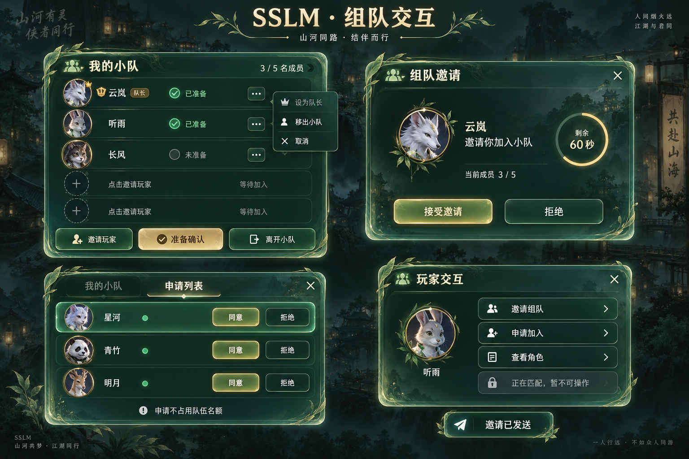
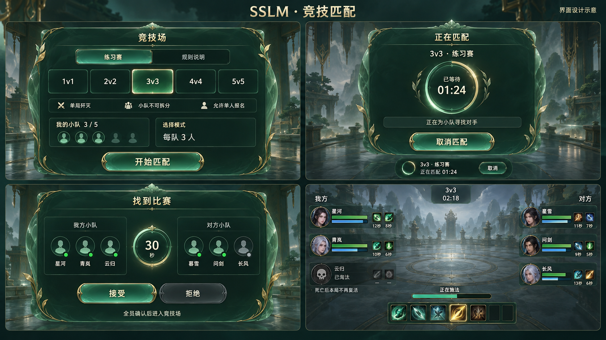
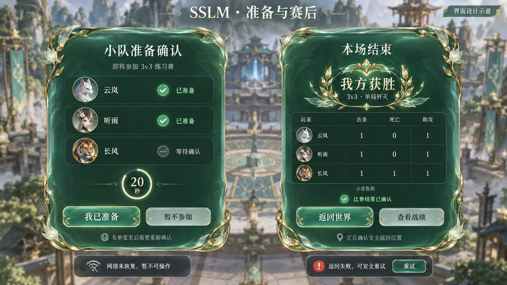

# SSLM组队与竞技界面设计及蓝图制作说明

日期：2026-10-14。当前交付：3幅原创界面概念图、9个页面蓝图的制作规范；**真实Widget Blueprint本轮新增0个，未编译、保存或重载任何相关蓝图**。本说明不替代Monolith资产证据、客户端交互或人工视觉验收。

## 设计图与视觉边界

采用电影级温润抛光自然碧绿玉石、低噪声背景、细金属包边和清晰的中文信息层级。借鉴普通MMO的队长权限、邀请确认、入队申请和竞技匹配交互，不复制魔兽世界纹理、人物、图标或品牌标识。概念图内姓名、头像和战斗数据只用于版式示例，不导入生产默认值，不冒充真实玩家或战斗记录。

### 组队管理、邀请、申请与目标菜单

该图对应公共队伍能力：最多5人，明确队长、在线及准备状态；队长可邀请和处理申请，普通玩家只能处理发给自己的邀请和自己的申请。目标菜单只针对当前合法可见玩家打开。头像与名称来自授权快照，不向Widget暴露账号凭据或隐藏属性。

### 五模式选择、排队、匹配确认与竞技HUD

模式完整展示1v1、2v2、3v3、4v4、5v5，但生产可用性必须由真实模式定义、规则与地图就绪状态决定；未配置模式禁用并显示原因。单人可直接报名，小队作为不可拆分单元报名；排队只显示可信的已等待时间，不编造预计等待时间。找到比赛的入场确认与进入竞技场后的赛前准备是两个不同阶段。

HUD兼顾己方／敌方框架、增减益、施法条和淘汰状态。只显示服务器授权可见的事实，不让表现资源决定命中、胜负或复活。单局歼灭下显示“本局已淘汰”，不提供自动复活倒计时。

### 小队准备与赛后结果／安全返回

准备确认绑定名单、活动、区域及其版本，任一条件变化必须失效。赛后页面区分结果提交中、已确认、返回准备中和可重试错误；只有取得后端重新确认的有效返回实例与安全落点后才允许应用流程转服，不复用旧地址。图中战绩已按单局歼灭约束修正，仍仅为示例，不是服务器结果。

三幅图为整体设计板，**不是可直接当作交互背景导入的整页运行纹理**。正式页面的文字、按钮、列表、计时与错误提示必须为独立控件；头像、装饰与图标另行由Monolith导入及核验。原图尺寸与SHA-256、原始提示词及一次战绩修正记录见[图像生成记录](Design/ImageGenerationPrompts_20261014.json)。

## 三层逻辑架构与插件所有权

| 层级／所有者 | 页面与类型的职责 | 依赖边界 |
| --- | --- | --- |
| GamePlatformUI（平台界面） | 已有页面、模态、菜单、根层栈、焦点、输入及主题语义机制 | 不新增SSLM资产路径、不认识生肖或竞技规则，不拥有队伍权威状态。 |
| GamePlatformOnline（平台在线） | 通用组队契约、身份、命令及取消机制的既有扩展边界 | 不依赖MOBA和项目UI；当前新增后端能力不代表UE适配已经接通。 |
| MobaCommon／GamePlatformArena（可选MOBA） | 五模式、比赛阶段、可见竞技事实与客户端观察语义 | 不认识SSLM纹理，不直接创建项目页面。已有抽象足够时不机械新增空父类。 |
| DBAClient／DivineBeastsUIClient（项目公共客户端） | 公共社交页面父类、ViewModel、目标菜单命令与路由 | 普通邀请／申请不依赖DBAArena，Widget不发送HTTP。 |
| DBAUIPack_Core（项目公共内容） | 5个公共组队页面及其公共纹理、样式的唯一资产所有者 | 保持纯内容插件；不增加C++模块或第二套在线执行器。 |
| DBAArena／DivineBeastsArenaClient（项目竞技） | 匹配、逐人确认、竞技HUD、结果与返回页面父类及竞技适配 | 复用下层与DBAClient公开契约，不让公共社交插件反向依赖竞技。 |
| DBAArena（项目竞技内容） | 4个既有竞技目录目标对应页面 | 不新增同名页面树、空内容插件或Server UI依赖；真地图仍归登记后的世界内容包。 |

单向类型关系示例为`GamePlatformUIScreen → DivineBeastsUIScreen → DivineBeastsSocialScreenBase → 公共Widget Blueprint`；竞技页面沿既有竞技客户端父类向下复用。没有独立MOBA结构的公共邀请不需要穿过MOBA层。内容包在第三层内部，不是第四层。 Dedicated Server不得加载这些纯客户端UI资产，源码目录归属不能替代最终产物审计。

## 蓝图制作清单

下表是**拟制作身份**，不是已存在资产列表。完整Widget树、逻辑尺寸、输入模式和按钮意图分别保存在公共及竞技制作规范；其中所有资产的`BlueprintCreated / Compiled / Saved / Reloaded`均为`false`。

| 所有者与拟定蓝图 | 原生父类（模块内） | 层栈／初始焦点 | 交互内容 |
| --- | --- | --- | --- |
| DBAUIPack_Core：`UI/Social/WBP_DBA_PartyPanel` | DivineBeastsUIClient.DivineBeastsSocialScreenBase | Screen／InviteButton | 成员、队长标识、在线与准备；邀请、准备确认、离队。 |
| DBAUIPack_Core：`UI/Social/WBP_DBA_PartyInviteModal` | DivineBeastsUIClient.DivineBeastsModalScreen | Modal／AcceptButton | 邀请者、人数、60秒有效期、接受／拒绝。 |
| DBAUIPack_Core：`UI/Social/WBP_DBA_PartyApplications` | DivineBeastsUIClient.DivineBeastsSocialScreenBase | Screen／ApplicationsList | 申请列表、120秒有效期、批准／拒绝、空列表及无权限状态。 |
| DBAUIPack_Core：`UI/Social/WBP_DBA_PlayerContextMenu` | DivineBeastsUIClient.DivineBeastsMenuScreen | System／InviteTargetButton | 邀请、申请加入、允许查看的角色信息；安全区内定位。 |
| DBAUIPack_Core：`UI/Social/WBP_DBA_PartyReadyCheckModal` | DivineBeastsUIClient.DivineBeastsModalScreen | Modal／ConfirmReadyButton | 20秒小队准备、成员确认、拒绝、名单变更失效。 |
| DBAArena：`UI/Screens/WBP_DBA_UI_Arena_Matchmaking` | DivineBeastsArenaClient.DivineBeastsMatchmakingScreen | Screen／ModeList | 五模式、规则、单人／小队报名、排队和取消。排队为同一页面的状态，不新建第二套流程。 |
| DBAArena：`UI/Screens/WBP_DBA_UI_Arena_MatchFoundReady` | DivineBeastsArenaClient.DivineBeastsMatchFoundReadyScreen | Modal／ReadyButton | 30秒找到比赛的逐人入场确认；不可绑定为场内SetArenaReady。 |
| DBAArena：`UI/HUD/WBP_DBA_UI_ArenaHUD` | DivineBeastsArenaClient.DivineBeastsArenaHUD | HUD／不抢焦点 | 1至5人队伍／敌方框架、Buff／Debuff、施法、时间和淘汰。 |
| DBAArena：`UI/Screens/WBP_DBA_UI_Arena_PostMatch` | DivineBeastsArenaClient.DivineBeastsPostMatchResultScreen | Screen／ReturnWorldButton | 可信结果、提交与返回状态、返回及可恢复重试。 |

- [公共5页制作规范](../../../Game/Plugins/DivineBeasts/ContentPacks/Presentation/DBAUIPack_Core/Docs/PartyUIBlueprintAuthoringSpec_20261014.json)。
- [竞技4页制作规范](../../../Game/Plugins/DivineBeasts/DBAArena/Docs/PartyArenaUIBlueprintAuthoringSpec_20261014.json)。

规范中的`WidgetTree`是供人工审核和后续工具转译的声明式设计，不是已经核对当前Monolith动作schema的可执行脚本。列表条目的真实Widget、图标、样式类和逐项命令桥接也须在编辑器恢复后制作；不以`EntryWidgetStatus=RequiresMonolithAuthoring`冒充已有条目资产。既有目录中如已有同路径资产，必须先回读并增量修改，不覆盖其旧数据。

## 状态、命令、输入与无障碍

- Widget只持有本地玩家作用域的显示状态和命令等待身份；收到同账号、同队伍且更新的Revision才应用业务快照，换账号／世界／失活立即解绑并取消自身等待。重新激活必须取得新快照，不把旧页面状态当作真源。
- `AllowedCommands`是拟增加的ViewModel能力快照，不是当前Social ViewModel已存在的API。服务器仍须独立验证队长、目标、名单锁和版本；禁用按钮只是界面反馈，不替代授权。
- 邀请、申请、离队、转让、踢人、解散、报名、取消、入场确认和返回均提交已有统一在线／应用流程中的明确命令，携带幂等请求身份和预期版本。按钮在命令处理中禁用；完成、失败、超时、结果未知分别提示，不能先乐观切成成功页面。
- 本轮后端命令源代码已经扩展，但UE Social命令桥、小队20秒准备会话、匹配订阅、逐人确认和队列编排尚未完整接通。规范用`PendingNativeCommandAdapter`明确标记，不能声称单击可运行。
- 业务状态由激活／失活、快照、命令完成、视口、安全区、输入设备和主题／本地化事件更新，禁止Widget Tick或属性绑定逐帧查询后端。剩余时间可用页面拥有的有限频率显示计时器，依据服务器UTC锚点计算，到期仅请求刷新／展示等待终态，不决定接受成功；失活清理计时器。
- 鼠标右键目标菜单按合法可见目标身份打开，背景装饰不截获点击。模态打开保存原焦点，关闭恢复调用入口；ESC关闭展示不自动等于拒绝。禁止关闭模态后把尚未完成的命令当作已撤销。
- 空列表、失去队长、目标离线、队伍已满／锁定、过期请求、同一玩家加入别队、版本冲突和网络失败均有明确中文原因。默认焦点控件禁用／空列表不可聚焦时，回退到可用关闭按钮或规则说明，不陷入焦点死路。
- 成员行提供独立导航及语义名称；用图标＋文字而非仅颜色区分队长、准备、离线、减益和淘汰。适配键鼠／手柄及缩放、长中文、视口安全区，正式尺寸以真实运行核验为准。

## 本轮编辑器与Monolith阻塞证据

已核对锁定引擎为`F:/UnrealEngine-5.8.0-release`，Build.version为5.8.0；启动目标为当前正式`Game/DivineBeastsArena.uproject`。本轮使用禁止编译、禁止LiveCoding／热重载的参数启动，进程随后退出，并未打开可编辑的正式工程。

实际日志：`Game/Saved/Logs/VillagePartyArenaEditor.log`，主要证据：

- 行1787附近：缺少`UnrealEditor-GamePlatformInteraction.dll`导入。
- 行2129附近：DivineBeastsApplicationFlowClient预载失败，缺少DBAWorldsRuntime依赖。
- 行2472—2473附近：DivineBeastsPresentationClient和DivineBeastsUIClient的导入／预载失败。
- 行3163：DBAArena所需DivineBeastsArenaClient无法加载，编辑器退出。
- Monolith的状态与UI动作发现均返回`Unreal Editor not running`；未获得可操作的Widget动作目录。

没有通过禁用所需插件启动一个缺少父类的替代工程，没有触发构建，也没有通过普通文件工具写入`.uasset`／`.umap`。本轮不向既有`MonolithGenerationManifest.json`追加任何生成成功条目。源码中能检索到父类不等于编辑器已经加载该类。

同日用户要求“启动编辑器后执行”后的再次尝试仍失败：新日志`Game/Saved/Logs/VillagePartyArenaEditor_Continue_20261014.log`行3164记录同一DBAArena模块加载错误，11:18:11关闭日志。文件级核对进一步澄清：GamePlatformInteraction的Editor DLL缺失，DBAWorldsRuntime和UIClient的DLL则实际存在但依赖加载失败，不能笼统称为全部DLL缺失。Monolith仍不可用，未执行新的资产制作；原“不构建”约束未被撤销，需先恢复匹配当前源码的Editor必要模块完整产物。

## 恢复后的执行顺序与验收

按后续统一构建安排恢复匹配源码的Editor模块后，应在**同一正式工程**执行：

1. 核对项目完整路径、UE5.8、Monolith实时版本和UI动作目录；逐一检查原生父类可加载、当前同路径资产、目录与内容扫描规则。先备份真实已有资产，再增量制作。
2. 公共5页只写入DBAUIPack_Core，竞技4页沿用DBAArena现有目录目标；制作所需列表条目，复用已核验的公共头像、主题和Roster能力，不另建插件或业务执行器。
3. 接通原生命令与事件快照。独立验证小队准备、找到比赛确认、场内准备的阶段身份；不以同名“准备”按钮复用错误命令。未接通能力禁用并显示真实原因。
4. 对每个资产执行Widget编译、保存、关闭／重开、父类及完整Widget树回读；检查命名控件、初始／回退焦点、导航、输入恢复、列表条目、权限与生命周期。只有真实成功才填入Monolith生成清单。
5. 新导入／重导入彩色UI执行当前原稿指纹阻断审计以及`DivineBeasts.UI.Color.SourceToSlate`真实RHI回读，核对测试确已加载且通过；不调用已知额外Gamma的`capture_scene_preview` widget路径，不反向修改源RGB补偿截图。
6. 在真实客户端覆盖邀请接受／拒绝／过期、申请批准／拒绝、队长交接／离队、同玩家竞争入队、整队与单人五模式、取消与结果未知、断线及跨世界清理；再补Client／Server产物剥离、Cook、设备适配及集中人工视觉验收。

当前可核验的是概念图文件、制作规范、已写入源码及编辑器失败证据；**尚无本轮蓝图资产级或运行交互级成功证据，整体功能未完成**。进一步进度与未执行检查见[实施记录](ExecutionProgress.md)。

## 同日Editor恢复后的最新状态

用户后续明确允许“仅构建正式工程Editor目标所需模块，然后重启编辑器”。既有`Build/Game/BuildFoundation.ps1 -Editor`已完成正式`DivineBeastsArenaEditor`／Win64／Development增量构建，退出0、UBT Succeeded；RunId为`28059359-95a3-4606-b54c-ffd4d256b115`，耗时约570秒，保留1条Combat的NetUpdateFrequency既有弃用警告。没有运行Client／Server、Go构建、Cook或打包。

重启后由编辑器自身Monolith MCP回读确认正式工程绝对路径、UE5.8.0、Monolith0.23.0及7个原生父类可加载，9个目标资产仍全部不存在。编辑器已经可交互；工具代理的状态探测仍误报不可用，本轮沿用工程既有协议直接访问同一编辑器的`/mcp`，实际动作发现、schema及只读查询成功，没有使用其他资产生成方式。此前失败日志保留为历史，不再代表当前编辑器状态。

两份制作JSON已同步Editor就绪／schema读取状态，但仍非通过Monolith dry-run的可执行文档。真实蓝图新增依然为0，未绑定命令、未编译保存重载、未追加生成成功清单。本次恢复只完成制作前提，不将其写成UI整体交付。详细命令、构建证据和编辑器日志见[实施记录](ExecutionProgress.md)的最新补充。

## 同日九页Monolith制作后的最新状态

以上“新增0”的段落保留为历史阶段，不再描述最新资产状态。本轮正式Editor PID57884、UE5.8.0、Monolith0.23.0经真实回读后，已创建公共组队五页、竞技四页、公共列表条目和一项UI域玉石材质，共11项真实资产。两份制作JSON已换成实际Widget树、记录编译/保存和待冷读状态；未使用概念PNG冒充蓝图，没有导入新位图或使用已知Gamma错误的widget预览。

原生代码已补普通小队严格DTO/认证请求、页面ViewModel、按钮/列表接线和可选竞技活动入口；竞技提供者使用既有MOBA端口，增加每本地玩家的注册、报名、取消及逐人回复入口和作用域保护。公共UI没有竞技依赖，竞技不在Widget中HTTP或直接切图。九页及条目集中编译零错误/零编译警告，静态可访问性问题已清零，不能据此推断真实后端联机或人工视觉通过。

用户追加要求先完成代码/蓝图，再组合编译和验证；现已转入集中正式Editor构建`64df7256-9b2a-439a-a326-769c8d4d8950`，构建结果、重启冷读和三个新增原生回归尚待实际结果。三层源码继承边界及公共禁竞技/竞技服务器禁客户端的静态依赖闭包已通过。

当前仍不具备完整线上闭环：真实Gateway没有观察/取消/逐人候选确认合同和生产客户端适配器，五模式仍NotConfigured；限时小队准备、未建队原子邀请和世界目标菜单调用方也尚未集成。对此保留能力门禁和明确说明，不把禁用按钮或端口声明写成后端实现完成。集中人工核验尚未开始，不要求用户分批验收。

## 最终集中验证结果

最新代码通过正式`DivineBeastsArenaEditor Win64 Development`全目标增量构建，RunId`c80c3bf0-6d27-4950-9836-cd62657c359e`、退出0；此前缺失必要引擎导入库和跨DLL符号的失败均保留，不以失败输出计作通过。没有运行Go、Client/Server、Cook/Stage或生产部署。

最终Editor进程11536重新从磁盘加载全部资产，确认正式工程与UE5.8.0/Monolith0.23.0身份。九页加公共条目共281节点、300项显式导航；父类、目标控件存在性、六个列表EntryWidgetClass与零设计预览项均一致，十个Widget的编译和静态可访问性检查均零问题。新增玉石材质确认为MD_UI、Translucent，材质图与11项资产冷读成功；未导入新位图，未宣称SourceToSlate颜色或人工视觉已验收。

相关原生回归在重启前后均实际执行：平台严格合同1/1、公共Party 2/2、竞技UI 6/6，共9/9通过，零错误/警告；另内建验证规则注册1/1通过。审查提出的池化绑定、键盘目标与确认终态三项已修正且对应回归通过。按用户要求集中验证，没有观察每项修改前的RED，不将本次结果称作TDD红绿闭环。

正式证据为`Saved/Validation/VillagePartyArena/NativeAndBlueprints_20261014/FinalColdReadback.json`和`FinalNativeAutomation.json`，原始Monolith请求/回执保留同目录。两份制作JSON及两份生成清单已同步真实结果，业务可用性、客户端运行、网络和人工视觉字段仍明确为未验收。焦点由真实C++ ScreenDefinition注入，未把Transient CDO值误作持久化焦点证明。

结论：本批“原生客户端命令入口、九页真实蓝图及集中技术验证”增量已落地；完整组队到竞技联机流程仍受上述后端与内容缺口阻断，不宣称任务1—6整体完成，不启动集中人工验收。

文档与生成清单更新后的正式Editor全目标收口结果：`65f8fb2d-813a-49f1-80ab-8d21280aa4e7`，退出0、Eligible，Target is up to date。此轮只确认最终输入和产物身份，没有额外源码编译；不能替代c80真实编译链接、原生回归或冷读证据。
