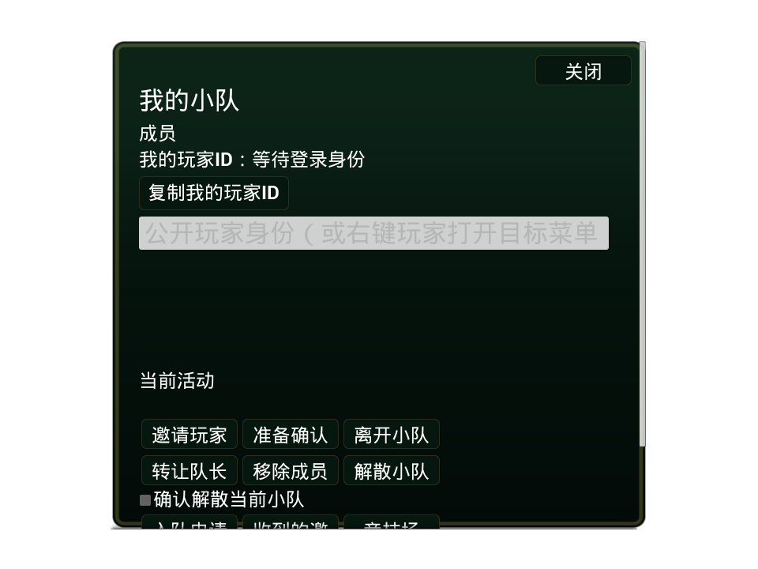

# SSLM 新手村狼怪物修复与组队竞技场操作（2026-10-16）

## 组队与进入竞技场

1. 两个客户端分别使用不同测试账号登录，选择角色并进入新手村。
2. 队友打开世界HUD的队伍/组队入口，在“我的小队”顶部点击“复制我的玩家ID”。这是服务器分配的公开玩家ID，不能用`player01`等登录账号名代替。
3. 队长打开同一页面，将对方ID粘贴到邀请目标输入框，点击“邀请”。未组队时发送邀请由后端建立队伍，不需要额外创建空队伍。
4. 队友打开“收到的邀请”列表，选中本次邀请并接受。新邀请也可能自动弹出；双方成员列表更新后才算组队成功。
5. 队长在小队面板向下滚动，点击“竞技场”，打开匹配页面，选择1v1、2v2、3v3、4v4或5v5，点击“开始匹配”。队伍人数不得超过单边人数；匹配不会拆开已有队伍。
6. 组队匹配会发起本次限时准备，所有成员确认准备后进入队列。找到比赛后，每名玩家还需要接受本次比赛确认；全部确认后由已有后端准入和客户端流程自动进入竞技场。
7. 单人可以直接从竞技场页面选模式并匹配，无需创建队伍。想用两个客户端互相对战，应分别单人排1v1；两人组队排2v2还需要另外两名玩家。3v3、4v4、5v5分别需要6、8、10名玩家。

队伍锁定、取消、错误和名单以服务器结果为准。按钮不可用时先查看页面状态说明；取消未确认前不要假定队伍已解锁。本次不新增另一套竞技场或组队执行器。

## 操作用户界面

本轮真实修改的是`/DBAUIPack_Core/UI/Social/WBP_DBA_PartyPanel`：成员数量下方增加公开玩家ID和复制按钮，邀请输入框及已有成员/管理/竞技入口保留原顺序。复用原有字体和按钮样式，支持键盘和手柄导航。

真实保存页面的RHI图像由`DivineBeasts.UI.Party.RHISavedPages`生成，保存到`Game/Saved/Validation/UIColorRHI/Party/`。该图像只展示未登录预览的实际Widget布局，不伪造成员或成功匹配状态。正式游戏需在登录后由真实账号快照填入ID和名单。

运行更新来自认证、页面生命周期和ViewModel变化通知。复制动作只处理当前激活且仍绑定本人认证来源的公开ID；退出账号、页面退休及池化换模型解除事件，密码和会话不进入剪贴板或界面默认值。

## 狼怪物根因与本次变更

此前资源配置为空且生成开关关闭；地图缺少NavMeshBoundsVolume，即使开启也无法通过服务器安全导航检查。现在通过Monolith真实导入Quaternius的CC0狼、建立Idle/Walking混合空间及平台动画基类派生AnimBP，创建服务器AI定义，烘焙出生点附近140×140米导航区域。

- 原两个PlayerStart保持`(0,0,120)`和`(240,0,120)`厘米。
- 最大4只狼，在出生点外26/34/42米候选区域生成，距任一出生点至少22米、狼间距至少5米；出生点20米内不造成狼咬伤害。
- AI、生命、咬击、死亡和刷新仍由专服结算；客户端只显示复制实体和动画。导航延迟完成通过通知补齐，不新增刷怪轮询。
- 模型显示比例0.25，不改变服务器碰撞胶囊或攻击距离。来源只有待机和行走两段动画；攻击、受击、死亡专用动画尚未提供。
- 本机VillageDevelopmentClient/Server显式启用，发行默认关闭。服务端剥离`Creatures/Wolf`纯表现叶子，保留`AI`、地图和导航。

首次真实专服启动还暴露了平台AI注册器无视`AutoPossessAI=Disabled`并提前创建通用控制器的问题。修复后保留项目显式狼控制器，且不再把控制器Owner反向设为Pawn（占有会把Pawn.Owner设为控制器，原写法形成所有权环）。新增真实世界回归覆盖禁止自动抢占、唯一控制器、无Owner环和75点初始生命；服务器生成失败也记录分阶段诊断，避免静默无怪。

FBX导入仅保存主网格不能证明子资产落盘。本轮显式补存骨架、两段动画与灰色材质，并重新打开编辑器核对；客户端IoStore逐项确认7项狼资源，服务器容器确认AI定义存在而外观叶子缺席。补存工具为`Tools/Unreal/Creatures/SaveVillageWolfImportDependenciesMonolith.py`。

原始资源作者与许可：[Quaternius原始发布](https://opengameart.org/content/animated-animales-low-poly)，CC0。只导入狼；来源、哈希、原始FBX/Blend和许可证存放于Village内容包的`SourceArt/Creatures/Wolf`。这是可见的低多边形狼，未冒称此前Fab方案的高精度狼或26段动画。

## 验证边界与证据

- 编辑器身份、资产编译/保存/原生重载、动画最终姿势连线、导航投影及出生点坐标：`Saved/Validation/VillageWolvesAndPartyUI20261016/AssetVerification.json`。
- 服务器表现资源策略32项轻量检查：同目录`ServerPolicyTests.log`；首次默认临时目录受沙箱限制，改用工作空间Saved临时目录后成功。
- 固定参数增量构建、4项定向原生检查、Client/Server Cook与进程启动结果以同目录`Pipeline.json`、`BuildAndCook.json`和`Runtime.json`为准。
- 资产/构建/Cook/进程启动分别验收，不代替玩家实际看到狼、多人攻击及组队跨服的人工确认。最终执行结果在本文件后续追加。

## 最终执行结果

- 固定参数：UE5.8，Development/Win64，NoSharedPCH、NoUBA、MaxParallelActions=8；Editor显式UsePrecompiled和DBAServer插件。
- Editor、客户端、服务器构建成功；实际运行发现控制器冲突后仅重编Editor/Server，复用未受影响客户端，不重复客户端Cook。
- 32项服务器资源策略检查、4项初轮狼/小队回归、更新后1项小队RHI导出、2项控制器/编辑世界回归均成功；真实SourceToSlate颜色门禁通过。
- 最新客户端与服务器Cook/Stage通过，服务器表现产物禁入数0；客户端容器含全部7项狼资源，服务器含AI定义并剥离外观。
- 最新专服已在(2600,0)、(0,2600)、(-2600,0)、(0,-2600)厘米各生成一只狼，控制器Owner环与生成拒绝日志未再出现。
- 两个SSLM客户端窗口已实际启动并核对PID/启动时间/路径；完整证据汇总为`Saved/Validation/VillageWolvesAndPartyUI20261016/FinalValidation.json`。
- 实际登录后的狼可见性、追击/伤害/刷新及多人组队进入竞技场仍属于人工/联机验收，未以进程存活或离屏截图冒充通过。资源为CC0低多边形狼，仅待机/行走两段动画。

以下为真实已保存控件的线性RHI预览（未登录，无伪造成员）：

竞技场入口在面板下方，向下滚动即可看到；登录后“等待登录身份”替换为当前账号公开玩家ID。
